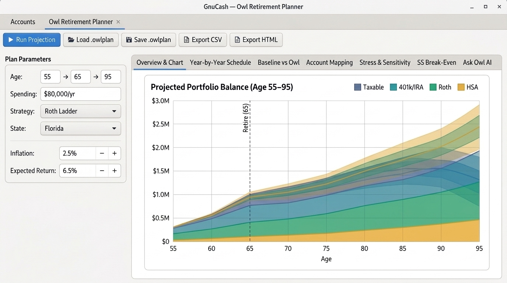
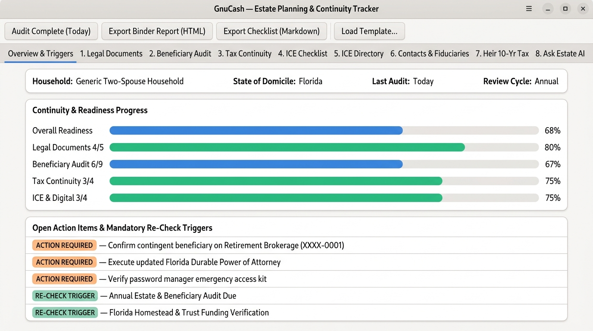

# gnucash_plus_owl *(Experimental)*

> [!WARNING]
> **Experimental & Unofficial Fork:** This repository (`gnucash_plus_owl`) is an **experimental** personal project based on GnuCash 5.x. It is **not affiliated with, endorsed by, or related to** the official [GnuCash](https://www.gnucash.org/) project or the official [Owl](https://github.com/mdlacasse/Owl) project. Do not use it for official financial, tax, or legal advice.

---

## Table of Contents

- [Overview](#overview)
- [Tool 1: Owl Retirement Planner](#tool-1-owl-retirement-planner)
- [Tool 2: Estate Planning & Continuity Tracker](#tool-2-estate-planning--continuity-tracker)
- [Building & Running](#building--running)
- [Upstream References & Licensing](#upstream-references--licensing)

---

## Overview

`gnucash_plus_owl` extends GnuCash (a personal and small-business double-entry accounting application) with two native C++17 / GTK3 planning tools under the **Tools** menu:

1. **Tools → Retirement Planner (Owl)…** — An Owl-inspired retirement income, Roth conversion, tax, healthcare (ACA/IRMAA), Monte Carlo, and AI What-If optimization engine.
2. **Tools → Estate Planning & Continuity…** — A state-aware estate readiness, beneficiary audit, SECURE Act 10-year tax, ICE directory, and AI continuity tracker.

- **Official GnuCash Home:** https://www.gnucash.org/
- **Official GnuCash Wiki:** https://wiki.gnucash.org/wiki/GnuCash
- **Official GnuCash Downloads:** https://www.gnucash.org/download

---

## Tool 1: Owl Retirement Planner

Available under **Tools → Retirement Planner (Owl)…**, this standalone module is inspired by the retirement planning concepts of [mdlacasse/Owl](https://github.com/mdlacasse/Owl).



### Account Mapping, Ledger Integration & Persistence
- **Live GnuCash Account Mapping & Expense Estimator:** Imports Asset/Bank/Stock/Mutual balances into `Taxable`, `Tax-Deferred` (401k/IRA), `Tax-Free` (Roth), `HSA`, and `Excluded` buckets, and includes **Est. Spend from GnuCash Book** to estimate annual spending from trailing 12-month Expense transactions.
- **Include Checkboxes, Search & Bulk Selection:** Individual `Include` checkboxes, live search filter, **Select All / Deselect All**, and **Auto-Classify** controls.
- **Preserved Manual Overrides & Persistent Selections:** Custom tax-bucket assignments and `Include` selections are persisted immediately per book (and preserved on **Refresh Accounts**).
- **Plan Files, Snapshots, Exports & In-App Help:**
  - **Plan ▾ → Save Plan As... / Load Plan...** (`*.owlplan`, `*.ini`) — automatically remembers and reloads your last `.owlplan` file on startup.
  - **Plan ▾ → Pin Snapshot (Plan A) / Clear Snapshot** for side-by-side **Plan A vs. Plan B** comparison.
  - **Plan ▾ → Export CSV... / Export HTML Report...** (print-ready HTML/PDF report with KPIs, SVG chart, Monte Carlo percentiles, Stress Tests, Historical Backtests, and Schedule).
  - **Help (F1):** Built-in 4-tab Owl Retirement Planner manual accessible via `F1`, **Help → Contents**, or the toolbar button.

### Tax, Healthcare & Optimization Engine
- **Two-Person Household (Spouse / Partner):** Optional spouse age/horizon/contributions, independent Social Security & pension modeling, survivor benefits, and joint SS claiming optimization.
- **Spending Phases, Bridge Income, Debt, LTC & One-Time Events:** Go-Go / Slow-Go / No-Go spending phase multipliers, part-time bridge income, fixed nominal debt/mortgage payoff schedules, late-life Long-Term Care (LTC) shock modeling, and custom lump-sum windfalls or expenses.
- **Asset Allocation Glide Path & Guardrails:** Optional pre-retirement to in-retirement equity/bond glide path driving expected return/volatility, plus Guyton-Klinger spending guardrails (±10%).
- **Custom Cost Basis, Per-Bucket Returns & Heir Tax Rate:** Configurable initial taxable cost-basis percentage (`%`) for LTCG estimation, independent expected return rates per tax bucket (`Taxable`, `401k/IRA`, `Roth`, `HSA`), and an optional heir marginal tax rate for after-tax bequest comparisons.
- **Federal Taxes, Brackets & Medicare:** Ordinary income tax, LTCG, NIIT, 2-year MAGI lookback IRMAA Medicare surcharges with cliff warnings, taxable Social Security calculation, and year-by-year **Bracket / IRMAA** tier diagnostics.
- **50-State + DC Tax Modeling:** State income tax rules including state retirement-income and Social Security exemptions.
- **Pre-Medicare ACA Modeling:** Pre-65 ACA Marketplace subsidies and optional 400% FPL cliff enforcement.
- **RMD Re-investment, Income Floor & Roth/SS Optimization:** SECURE 2.0 RMD projections with optional after-tax RMD surplus re-investment into the taxable bucket, optional inflation-adjusted TIPS/annuity income floor tracking, Roth conversion bracket-fill strategies (`12%`, `22%`, `24%`), and Social Security claiming age optimization (`62–70`).

### Interactive Charts, Stress Testing & Ask Owl AI
- **5 Chart Modes with Hover Tooltips:** `Portfolio by Tax Bucket`, `Income & Withdrawals`, `Taxes, RMDs & Roth Conv`, `Monte Carlo Fan (P10–P90)`, and `Tax & Healthcare Breakdown`.
- **Stress & Sensitivity Tab:** Sequence-of-returns stress scenarios (Early Crash, Lost Decade, Stagflation), a 5×5 Return vs. Spending sensitivity matrix, and **Historical Market Backtests (1928–2024)** across 97 rolling cycles.
- **SS Break-Even Tab:** Cumulative Social Security benefits across claiming ages `62–70` with break-even ages vs. 62 and 67.
- **Ask Owl AI Tab:**
  - Supports **Local Ollama (Offline)**, **Google Gemini**, and **OpenAI-Compatible** endpoints with live token streaming, **Refresh Models**, and a **Stop** button.
  - Includes **Prompt Presets** (such as *Analytical Financial Planner (Show Math)*, *Concise Owl Advisor*, *Roth & Tax-Bracket Strategist*, *Sequence-of-Returns & Stress Auditor*, and *Custom System Prompt*) with an editable system prompt.
  - Sends only a privacy-safe, anonymized numeric plan summary and supports 1-click **Apply AI Suggestion** for What-If JSON responses.
  - All AI model settings (`Provider`, `Model`, `Endpoint`, `API Key`, `Prompt Preset`, and `System Prompt`) persist automatically across sessions and books.

---

## Tool 2: Estate Planning & Continuity Tracker

Available under **Tools → Estate Planning & Continuity…**, this module tracks legal documents, account beneficiaries, tax-continuity rules, key contacts, and emergency (ICE) records in one persistent workspace.



### Tabs & Capabilities
1. **Overview & Triggers:**
   - Editable household, heirs, attorney, safe/binder location, and annual audit metadata.
   - **50-State + DC Selector** with automatic state-specific guidance (e.g. state estate tax, state inheritance tax, community property rules, or Florida Homestead / TBE / Lady Bird Deed / non-springing POA rules).
   - Overall and per-section readiness progress bars plus a live **Open Action Items & Mandatory Re-Check Triggers** feed.
2. **1. Legal Documents:**
   - Tracks core instruments (Last Will & Testament with Self-Proving Affidavit, Revocable Living Trust / Lady Bird or TOD Deed, Durable Financial Power of Attorney, Health Care Surrogate / Proxy & HIPAA Release, and Living Will) with status (`Not Started`, `In Progress`, `Attorney Review`, `Completed`), due/triggers, owner, completion dates, notes, and attached **Document Links** (**Browse…** / **Open**).
3. **2. Beneficiary Audit:**
   - Tracks primary and contingent (*per stirpes* / *per capita*) designations, JTWROS/TBE/TOD/POD titling, mandatory re-check triggers, and attached confirmation PDFs.
   - **GnuCash Account Linking & Unlinked Account Alerts:** Link rows directly to GnuCash asset/investment accounts, click **Sync Linked GnuCash Values** to refresh balances from your book, and view a banner flagging any positive-balance GnuCash accounts not yet covered in the audit.
   - **Stale-Audit Highlighting:** Color-codes rows (green = verified within 12 months, amber = stale >12 months, rust = unverified) and provides **Audit Complete (Today)** in the toolbar to stamp today's audit date.
4. **3. Tax Continuity:**
   - Tracks tax-continuity rules including the HSA Non-Spouse Tax Trap, SECURE Act 10-Year Rule Roth conversion planning, *per stirpes* confirmations, Survivor Social Security Playbooks, and dependent health coverage transitions.
5. **4. ICE Checklist & 5. ICE Directory:**
   - Checklist and structured "In Case of Emergency" directory covering financial institutions, insurance policies, property tax parcels, password manager / hardware 2FA recovery locations, and email/domain continuity (with reminders not to store raw passwords).
6. **6. Contacts & Fiduciaries:**
   - Roster for Personal Representative (Executor), Backup Executor, Financial POA Agents, Health Care Surrogates, Estate Attorney, CPA, and Insurance Agent.
7. **7. Heir 10-Yr Tax Estimator (SECURE Act):**
   - Models the 10-year inherited Traditional IRA vs. Roth distribution schedule (*Even 10-Year Spread* vs. *Year-10 Lump Sum*), per-heir after-tax totals, and Roth conversion tax savings, with **Pull IRA/401k/Roth from GnuCash Book**.
8. **8. Ask Estate AI:**
   - Shares your persistent AI configuration (`Ollama`, `Gemini`, `OpenAI-Compatible`) and sends a privacy-safe estate summary (excluding raw account numbers, safe locations, emails, and phone numbers) for quick **Audit Estate Gaps**, **State & Probate Risks**, **Heir 10-Yr Tax**, and custom Q&A.

### Templates, Persistence & Binder Exports
- **Auto-Save:** Every toggle, edit, and tab close saves automatically to `~/.local/share/gnucash/estate-plan.conf` and the GnuCash book state.
- **Load Template…:** Choose between the **Florida Estate & Continuity Template** or a state-neutral **Generic US Template** tailored to your selected state.
- **Exports:** **Export Binder Report (HTML)** (printable report for a physical fireproof estate binder) and **Export Checklist (Markdown)**.

---

## Building & Running

See [`README.dependencies`](README.dependencies) and [`cmake/README_CMAKE.txt`](cmake/README_CMAKE.txt) for full GnuCash build prerequisites.

```bash
# Configure and build (example)
cmake -B build -G Ninja
cmake --build build --target gnucash test-retirement-engine -j4

# Run the retirement engine unit tests
./build/bin/test-retirement-engine

# Launch GnuCash
./build/bin/gnucash
```

---

## Upstream References & Licensing

- See [`ATTRIBUTIONS.md`](ATTRIBUTIONS.md) for upstream repository attributions and license accounting.
- See [`LICENSE`](LICENSE) for GNU General Public License terms, and [`README`](README) for the original GnuCash plain-text README.
